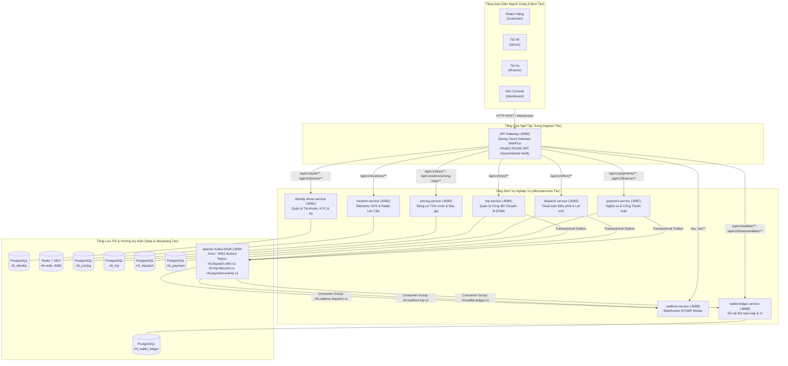
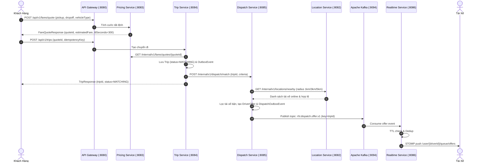
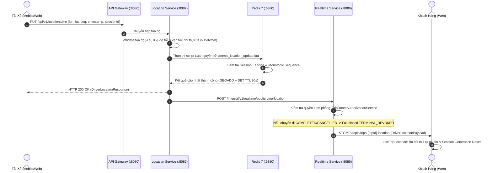
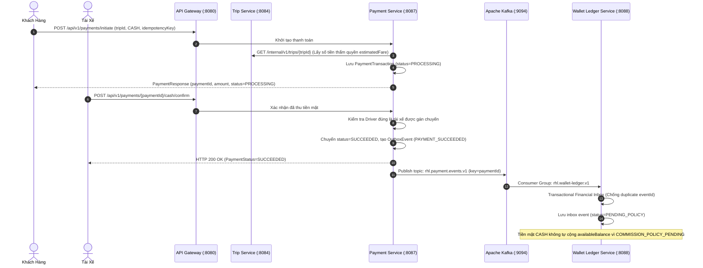
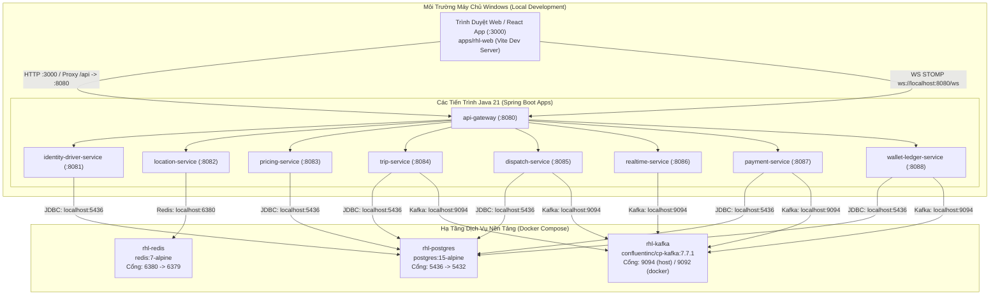

# TÀI LIỆU KIẾN TRÚC TỔNG THỂ HỆ THỐNG
## Ride-Hailing & Logistics Platform — Mã hiệu IEEE 830: SRS-RHL-002 v1.0

---

## 1. TỔNG QUAN KIẾN TRÚC TỔNG THỂ (SYSTEM ARCHITECTURE)

Hệ thống Ride-Hailing & Logistics (RHL) được thiết kế theo mô hình Microservices phân tán cao cấp, áp dụng mẫu thiết kế Database-per-Service, phân tách ranh giới rõ ràng (Bounded Contexts) và kết hợp hài hòa giữa giao tiếp đồng bộ HTTP REST/JSON cho các tác vụ nghiệp vụ xác định và giao tiếp bất đồng bộ qua Apache Kafka KRaft cho các sự kiện phân tán.

### Sơ đồ 1: Tổng thể Kiến trúc Toàn Hệ thống



### Các bước hoạt động và thành phần tương ứng:
1. **Cửa ngõ đơn (Single Ingress Point)**: [GatewaySecurityConfig.java](apps/api-gateway/src/main/java/com/rhl/gateway/config/GatewaySecurityConfig.java) tiếp nhận toàn bộ lưu lượng, giải mã chữ ký số RS256 qua khóa công khai và từ chối ngay lập tức token giả mạo hoặc hết hạn.
2. **Ngăn chặn lộ lọt nội bộ**: Cổng Gateway cấu hình chặn triệt để mọi yêu cầu từ mạng ngoài cố ý truy cập vào đường dẫn có tiền tố `/internal/**`.
3. **Database-per-Service**: Mỗi microservice sở hữu một schema cơ sở dữ liệu hoàn toàn độc lập trong PostgreSQL 15, nghiêm cấm quan hệ khóa ngoại xuyên cơ sở dữ liệu.
4. **Định vị không gian tách biệt**: [DriverLocationService.java](apps/location-service/src/main/java/com/rhl/location/services/DriverLocationService.java) lưu trữ tọa độ tần suất cao trực tiếp trên Redis GEO, không ghi xuống đĩa cơ sở dữ liệu quan hệ.
5. **Giao tiếp liên dịch vụ (Machine-to-Machine)**: Các lời gọi REST nội bộ được bảo vệ bởi [InternalAuthFilter.java](apps/identity-driver-service/src/main/java/com/rhl/identity/security/InternalAuthFilter.java) với cơ chế xác thực bí mật máy chủ và chống tấn công timing attack.
6. **Xương sống hướng sự kiện**: [docker-compose.yml](infra/docker-compose.yml) vận hành Apache Kafka single-node chế độ KRaft phân phối tin cậy các biến động nghiệp vụ.

---

## 2. LUỒNG ĐẶT CHUYẾN & ĐIỀU PHỐI (BOOKING & MATCHING FLOW)

Quá trình từ lúc khách hàng yêu cầu báo giá cho đến khi tìm được tài xế phù hợp được điều phối chặt chẽ qua 6 dịch vụ.

### Sơ đồ 2: Luồng Đặt Chuyến và Điều Phối Xe



### Các bước hoạt động và thành phần tương ứng:
1. **Báo giá bất biến**: [FareQuoteService.java](apps/pricing-service/src/main/java/com/rhl/pricing/services/FareQuoteService.java) phát hành báo giá với TTL 300 giây, bảo vệ chống giả mạo giá cước từ client.
2. **Khởi tạo chuyến đi**: [TripService.java](apps/trip-service/src/main/java/com/rhl/trip/services/TripService.java) đối chiếu `quoteId` với Pricing Service, chuyển trạng thái chuyến đi sang `MATCHING`.
3. **Kích hoạt điều phối**: [MatchingOrchestrator.java](apps/dispatch-service/src/main/java/com/rhl/dispatch/services/MatchingOrchestrator.java) quét bán kính đa tầng (1km, 3km, 5km) gọi sang Location Service.
4. **Kiểm tra tài xế hợp lệ**: [InternalLocationController.java](apps/location-service/src/main/java/com/rhl/location/controllers/InternalLocationController.java) chỉ trả về các tài xế có trạng thái hoạt động thực tế trên Redis presence key.
5. **Khóa slot lời mời nguyên tử**: Ràng buộc [uk_driver_offers_single_pending_per_driver](apps/dispatch-service/src/main/resources/db/migration/V1__create_dispatch_tables.sql) đảm bảo 1 tài xế chỉ nhận tối đa 1 lời mời đang chờ xử lý tại một thời điểm.
6. **Xuất bản sự kiện Outbox**: [DispatchOutboxPublisher.java](apps/dispatch-service/src/main/java/com/rhl/dispatch/services/DispatchOutboxPublisher.java) đẩy sự kiện lời mời sang Kafka broker.
7. **Phân phối STOMP riêng tư**: [DispatchOfferKafkaListener.java](apps/realtime-service/src/main/java/com/rhl/realtime/consumers/DispatchOfferKafkaListener.java) kiểm tra TTL và gửi qua kênh WebSocket riêng của tài xế.

---

## 3. KIẾN TRÚC TRANSACTIONAL OUTBOX QUA KAFKA (KAFKA EVENT FLOW)

Mẫu thiết kế Transactional Outbox 5 bước đảm bảo độ tin cậy At-Least-Once, loại bỏ hoàn toàn hiện tượng Dual-Write và tách biệt ranh giới mạng khỏi database transaction.

### Sơ đồ 3: Luồng Xử Lý Transactional Outbox và Consumer Idempotency

```mermaid
flowchart TD
    subgraph ServiceDB["Database Giao Dịch Nội Bộ"]
        BusinessTx["1. Nghiệp Vụ Chính Commit\n(Trip/Offer/Payment + OutboxEvent)"] -->|Atomic Commit| OutboxTable[("Bảng {service}_outbox_events\n(Trạng thái: PENDING)")]
    end

    subgraph OutboxWorker["Outbox Scheduled Poller (5 Bước Chuẩn Mực)"]
        Poller["Publisher Poller Worker"]
        TxService["OutboxTxService (REQUIRES_NEW)"]
        
        Poller -->|2. Atomic Claim| TxService
        TxService -->|UPDATE next_retry_at = now + 30s\nWHERE status=PENDING AND next_retry_at <= now| OutboxTable
        
        Poller -->|3. Kafka Send mạng\n(Ngoài DB Transaction)| KafkaProducer["KafkaTemplate Publisher\n(acks=all, retries=3)"]
        KafkaProducer -->|Gửi tới Broker| KafkaTopic[("Apache Kafka Topic\nPartition Key: tripId / paymentId")]
        KafkaTopic -->|Broker Acknowledgment| KafkaProducer
        
        KafkaProducer -->|4. Broker ACK Thành Công| Poller
        Poller -->|5. markSent có Fencing\n(next_retry_at = expectedLease)| TxService
        TxService -->|UPDATE status=SENT| OutboxTable
    end

    subgraph KafkaConsumers["Kafka Consumer Engine"]
        Listener["@KafkaListener (AckMode.RECORD)"]
        KafkaTopic -->|Poll Message| Listener
        
        DedupCheck{"Kiểm Tra Đã Xử Lý?\n(Read-only check)"}
        Listener --> DedupCheck
        
        DedupCheck -- Đã tồn tại --> SkipDrop["Bỏ qua an toàn (Idempotent Drop)"]
        DedupCheck -- Chưa xử lý --> BusinessHandler["Thực hiện Xử lý Nghiệp vụ\n(STOMP Push / Financial Inbox)"]
        
        BusinessHandler --> SuccessRecord["Đánh Dấu markProcessed(eventId)"]
        SuccessRecord --> CommitOffset["Commit Kafka Offset"]
        
        BusinessHandler -- Lỗi Tạm Thời --> ThrowsEx["Ném Ngoại Lệ cho Container"]
        ThrowsEx --> RetryBackoff["Spring Kafka ErrorHandler Retry 3 lần"]
        RetryBackoff -- Vượt số lần retry --> DLT[("Topic Dead Letter Queue (.dlt)")]
    end
```

### Các bước hoạt động và thành phần tương ứng:
1. **Nguyên tử trong Local Transaction**: Entity nghiệp vụ và bản ghi Outbox được commit trong cùng 1 database transaction cục bộ, loại trừ rủi ro mất mát dữ liệu khi hệ thống gặp sự cố mất điện.
2. **PostgreSQL Atomic Claim**: [DispatchOutboxTxService.java](apps/dispatch-service/src/main/java/com/rhl/dispatch/services/DispatchOutboxTxService.java) thực hiện UPDATE trực tiếp tận dụng Row-level Lock của PostgreSQL, chặn đứng race condition giữa các worker đồng thời.
3. **Lease Owner Fencing**: Phương thức `markSent` và `markFailed` bắt buộc khớp `next_retry_at = expectedClaimUntil`, vô hiệu hóa an toàn worker cũ nếu đã bị hết hạn lease.
4. **Broker ACK tin cậy**: [KafkaTripEventPublisher.java](apps/trip-service/src/main/java/com/rhl/trip/services/KafkaTripEventPublisher.java) sử dụng `acks=all` và `enable.idempotence=true`.
5. **Khử trùng 2 pha ở Consumer**: [TripLifecycleKafkaListener.java](apps/realtime-service/src/main/java/com/rhl/realtime/consumers/TripLifecycleKafkaListener.java) chỉ ghi nhận `markProcessed` sau khi STOMP dispatch hoàn thành, bảo vệ event không bị mất khi gặp retry mạng.
6. **Cách ly tin độc (DLT)**: Các thông điệp sai cấu trúc không thể giải mã được chuyển vào Dead Letter Topic bởi [KafkaRealtimeConsumerConfig.java](apps/realtime-service/src/main/java/com/rhl/realtime/configs/KafkaRealtimeConsumerConfig.java).

---

## 4. ĐỊNH VỊ GPS VÀ WEBSOCKET STOMP (GPS & REALTIME STREAMING)

Dữ liệu định vị GPS tần suất cao (1-3 giây/lần) được cách ly trên Redis GEO và STOMP WebSocket, tuyệt đối không đưa vào Kafka nhằm bảo vệ hiệu năng broker.

### Sơ đồ 4: Luồng Định Vị GPS và Phát Tín Hiệu Thời Gian Thực



### Các bước hoạt động và thành phần tương ứng:
1. **Lọc dữ liệu ngoại lai**: [GeoUtils.java](apps/location-service/src/main/java/com/rhl/location/utils/GeoUtils.java) kiểm tra tính hợp lệ của tọa độ, độ chính xác (accuracy threshold) và cự ly nhảy vọt bất thường.
2. **Session Fencing trên Redis**: [atomic_location_update.lua](apps/location-service/src/main/resources/scripts/atomic_location_update.lua) từ chối gói tin từ phiên cũ với mã lỗi `-4` (HTTP 409 `STALE_SESSION_PACKET`).
3. **Phòng thủ đa tầng thu hồi phòng GPS**: [TripProgressionService.java](apps/trip-service/src/main/java/com/rhl/trip/services/TripProgressionService.java) gọi HTTP `revokeTripRoom` tức thời khi chuyến đi kết thúc, kết hợp với Kafka event thu hồi phòng bất đồng bộ.
4. **Khóa thẩm quyền kết thúc (Terminal Guard)**: [HttpTripMembershipProvider.java](apps/realtime-service/src/main/java/com/rhl/realtime/services/HttpTripMembershipProvider.java) duy trì danh sách `terminalTrips`, lập tức loại bỏ mọi gói tin GPS đến trễ của chuyến đi đã hoàn thành.
5. **Chống giật lùi tọa độ trên Web**: [useTripLocation.ts](apps/rhl-web/src/hooks/useTripLocation.ts) áp dụng hàm kiểm tra khóa hợp phần: mốc thời gian máy chủ `observedAt` kết hợp với số `sequenceNumber`.

---

## 5. LUỒNG THANH TOÁN TIỀN MẶT VÀ SỔ CÁI TÀI CHÍNH (PAYMENT & WALLET LEDGER)

Kiểm soát chặt chẽ nghĩa vụ thanh toán và bảo toàn nguyên tắc kế toán kép bất biến.

### Sơ đồ 5: Luồng Thanh Toán Tiền Mặt và Bút Toán Sổ Cái



### Các bước hoạt động và thành phần tương ứng:
1. **Giá trị thẩm quyền bất biến**: [PaymentService.java](apps/payment-service/src/main/java/com/rhl/payment/services/PaymentService.java) lấy giá cước trực tiếp từ Trip snapshot, client không được truyền số tiền.
2. **Chống thanh toán trùng lặp (Zero Double-Charging)**: Ràng buộc [uk_payments_trip_single_success](apps/payment-service/src/main/resources/db/migration/V1__create_payment_tables.sql) đảm bảo đúng 1 giao dịch thành công duy nhất cho mỗi cuốc xe.
3. **Phân quyền xác nhận tiền mặt**: [DriverPaymentController.java](apps/payment-service/src/main/java/com/rhl/payment/controllers/DriverPaymentController.java) xác thực `authenticatedDriverId == trip.driverId`, từ chối tài xế lạ với HTTP 403.
4. **Sổ cái Bút toán kép bất biến**: [LedgerPostingService.java](apps/wallet-ledger-service/src/main/java/com/rhl/wallet/services/LedgerPostingService.java) bắt buộc $\sum \text{DEBIT} == \sum \text{CREDIT}$, append-only.
5. **Cơ chế Financial Inbox**: [FinancialEventIngestionService.java](apps/wallet-ledger-service/src/main/java/com/rhl/wallet/services/FinancialEventIngestionService.java) bảo vệ khử trùng và phân tách an toàn giữa các giao dịch CASH và DIGITAL.

---

## 6. MÔ HÌNH VẬN HÀNH & TRIỂN KHAI (RUNTIME & DEPLOYMENT TOPOLOGY)

### Sơ đồ 6: Cấu Trúc Triển Khai và Cổng Giao Tiếp Mạng



### Các bước hoạt động và thành phần tương ứng:
1. **Cô lập hạ tầng qua Docker**: File cấu hình [docker-compose.yml](infra/docker-compose.yml) quản lý 3 containers nền tảng với dữ liệu bền vững trên các volumes Docker.
2. **Thiết lập mạng Kafka kép**: Listener `EXTERNAL://0.0.0.0:9094` phục vụ các ứng dụng Spring Boot chạy trên host Windows, và listener `PLAINTEXT://rhl-kafka:9092` phục vụ mạng nội bộ container.
3. **Phân phối cổng chuẩn hóa**: Các cổng từ `:8080` đến `:8088` được gán cố định, tránh xung đột tài nguyên mạng.
4. **Môi trường Web tối ưu**: Ứng dụng [rhl-web](apps/rhl-web/) sử dụng reverse proxy tích hợp trong `vite.config.ts`, định tuyến toàn bộ request `/api/**` về Gateway `:8080` để phòng tránh lỗi CORS.
