# KIẾN TRÚC HỆ THỐNG EVENT-DRIVEN VỚI APACHE KAFKA
## Giai đoạn G1 & G2: Payment, Dispatch & Trip Outbox → Apache Kafka → Realtime STOMP / Wallet Ledger

---

## 1. TỔNG QUAN KIẾN TRÚC & PHẠM VI (SCOPE & ARCHITECTURE)

Hệ thống Ride-Hailing & Logistics áp dụng kiến trúc hướng sự kiện (Event-Driven Architecture - EDA) với **Apache Kafka** làm xương sống phân phối sự kiện (Event Streaming Backbone) giữa các Bounded Contexts.

### Phạm vi triển khai:
- **G1 (Financial Integration)**:
  - **Payment Service** (`:8087`): Phát các sự kiện biến động thanh toán (`PAYMENT_SUCCEEDED`, `PAYMENT_REFUNDED`) thông qua Transactional Outbox 5-bước.
  - **Wallet Ledger Service** (`:8088`): Tiêu thụ sự kiện, ghi nhận bất biến vào Financial Inbox (`financial_inbox_events`), bảo vệ tính toàn vẹn của Sổ cái kế toán kép (Double-Entry Bookkeeping).
- **G2 (Realtime Notification & Lifecycle Integration)**:
  - **Dispatch Service** (`:8085`): Phát các sự kiện Lời mời nhận chuyến (`DISPATCH_OFFER_CREATED`, `DISPATCH_OFFER_REVOKED`, `DISPATCH_OFFER_EXPIRED`) qua Transactional Outbox sang Kafka topic `rhl.dispatch.offer.v1`.
  - **Trip Service** (`:8084`): Phát các sự kiện Vòng đời chuyến đi (`TRIP_STATUS_CHANGED`, `TRIP_ACCEPTED`, `TRIP_COMPLETED`, `TRIP_CANCELLED`...) qua Transactional Outbox sang Kafka topic `rhl.trip.lifecycle.v1`.
  - **Realtime Service** (`:8086`): Nhận sự kiện qua `@KafkaListener`, thực hiện khử trùng (dedup), kiểm tra thời hạn TTL, phát hiện sự kiện cũ/ngược thứ tự (monotonic sequence check), thu hồi phòng STOMP khi kết thúc chuyến (P0 Terminal Room Revocation), và phân phối tới trình duyệt qua STOMP/WebSocket.

```mermaid
flowchart TD
    subgraph DispatchContext["apps/dispatch-service (:8085)"]
        D_DB[(PostgreSQL\nrhl_dispatch)]
        D_Tx["Matching & Offer Tx\n(DriverOffer + OutboxEvent)"] -->|Commit atomic| D_DB
        D_Poller["DispatchOutboxPublisher\n(Scheduled Worker)"]
        D_TxService["DispatchOutboxTxService\n(Short DB Tx REQUIRES_NEW)"]
        D_Producer["KafkaDispatchEventPublisher\n(KafkaTemplate)"]
        
        D_Poller -->|1. Claim lease 30s| D_TxService
        D_TxService -->|UPDATE next_retry_at| D_DB
        D_Poller -->|2. Send outside DB tx| D_Producer
        D_Producer -->|4. Broker ACK OK| D_Poller
        D_Poller -->|5. markSent| D_TxService
        D_TxService -->|UPDATE status=SENT| D_DB
    end

    subgraph TripContext["apps/trip-service (:8084)"]
        T_DB[(PostgreSQL\nrhl_trip)]
        T_Tx["Trip Progression Tx\n(Trip + StatusHistory + OutboxEvent)"] -->|Commit atomic| T_DB
        T_Poller["TripOutboxPublisher\n(Scheduled Worker)"]
        T_TxService["TripOutboxTxService\n(Short DB Tx REQUIRES_NEW)"]
        T_Producer["KafkaTripEventPublisher\n(KafkaTemplate)"]
        
        T_Poller -->|1. Claim lease 30s| T_TxService
        T_TxService -->|UPDATE next_retry_at| T_DB
        T_Poller -->|2. Send outside DB tx| T_Producer
        T_Producer -->|4. Broker ACK OK| T_Poller
        T_Poller -->|5. markSent| T_TxService
        T_TxService -->|UPDATE status=SENT| T_DB
    end

    subgraph KafkaBackbone["Apache Kafka Broker (KRaft Mode :9094 host / :9092 internal)"]
        Topic_Dispatch["Topic: rhl.dispatch.offer.v1\n(Key: tripId, 3 Partitions)"]
        Topic_Trip["Topic: rhl.trip.lifecycle.v1\n(Key: tripId, 3 Partitions)"]
        Topic_Payment["Topic: rhl.payment.events.v1\n(Key: paymentId, 3 Partitions)"]
        Topic_Dispatch_DLT["Topic: rhl.dispatch.offer.v1.dlt\n(Poison Pill / Non-retryable)"]
        Topic_Trip_DLT["Topic: rhl.trip.lifecycle.v1.dlt\n(Poison Pill / Non-retryable)"]
    end

    subgraph RealtimeContext["apps/realtime-service (:8086)"]
        R_DispatchListener["DispatchOfferKafkaListener\n(group: rhl.realtime.dispatch.v1)"]
        R_TripListener["TripLifecycleKafkaListener\n(group: rhl.realtime.trip.v1)"]
        R_Publisher["DefaultRealtimeEventPublisher\n(SimpMessagingTemplate)"]
        R_Membership["TripMembershipProvider\n(Cache Invalidation)"]
        
        Topic_Dispatch -->|Poll record| R_DispatchListener
        Topic_Trip -->|Poll record| R_TripListener
        
        R_DispatchListener -->|TTL check & Dedup| R_Publisher
        R_TripListener -->|Sequence check & Dedup| R_Publisher
        R_TripListener -->|Terminal status: revoke| R_Membership
        
        R_Publisher -->|STOMP Private| DriverWS["/user/{driverId}/queue/offers"]
        R_Publisher -->|STOMP Private| CustomerWS["/user/{customerId}/queue/trips"]
    end

    D_Producer -->|3. acks=all, tripId key| Topic_Dispatch
    T_Producer -->|3. acks=all, tripId key| Topic_Trip
```



---

## 2. DANH MỤC TOPIC & CHIẾN LƯỢC PHÂN VÙNG (TOPIC CATALOG)

| Tên Topic | Producer | Consumer Group | Số Partitions | Khóa phân vùng (Key) | Đảm bảo thứ tự |
|---|---|---|---|---|---|
| `rhl.payment.events.v1` | Payment Service | `rhl.wallet-ledger.v1` | 3 | `paymentId` (UUID) | Strict FIFO cho từng khoản thanh toán |
| `rhl.payment.events.v1.dlt` | Payment Service | Alerting / Audit | 3 | `paymentId` (UUID) | Dead Letter Topic cho sự kiện thanh toán lỗi |
| `rhl.dispatch.offer.v1` | Dispatch Service | `rhl.realtime.dispatch.v1` | 3 | `tripId` (UUID) | Strict FIFO cho toàn bộ offer của cùng 1 chuyến đi |
| `rhl.dispatch.offer.v1.dlt` | Dispatch Service | Alerting / Audit | 3 | `tripId` (UUID) | Dead Letter Topic cho offer event sai cấu trúc |
| `rhl.trip.lifecycle.v1` | Trip Service | `rhl.realtime.trip.v1` | 3 | `tripId` (UUID) | Strict FIFO cho toàn bộ bước chuyển trạng thái của 1 chuyến đi |
| `rhl.trip.lifecycle.v1.dlt` | Trip Service | Alerting / Audit | 3 | `tripId` (UUID) | Dead Letter Topic cho trip event sai cấu trúc |

### Chiến lược Partitioning theo `tripId`
- **Nguyên tắc**: Sử dụng `tripId` làm Partition Key cho cả Dispatch Offer và Trip Lifecycle topics.
- **Ý nghĩa kỹ thuật**:
  - Toàn bộ sự kiện thuộc cùng một chuyến đi (`DISPATCH_OFFER_CREATED`, `DISPATCH_OFFER_EXPIRED`, `TRIP_ACCEPTED`, `PICKING_UP`, `ARRIVED`, `IN_TRIP`, `COMPLETED`) luôn được hash vào **cùng một partition** duy nhất trên broker.
  - Kafka bảo đảm thứ tự tuần tự tuyệt đối (Strict FIFO Ordering) trong phạm vi một partition.
  - Các chuyến đi khác nhau (`tripId` khác nhau) được phân bổ đồng đều trên 3 partitions, cho phép scale song song ngang hàng.

---

## 3. HỢP ĐỒNG SỰ KIỆN DOMAIN (EVENT CONTRACTS)

### 3.1 Dispatch Offer Event Contract (`rhl.dispatch.offer.v1`)

```json
{
  "eventId": "e9c14828-e56d-4952-b1d1-4475ee7b5145",
  "eventType": "DISPATCH_OFFER_CREATED",
  "occurredAt": "2026-10-27T12:00:00Z",
  "recipient": {
    "type": "DRIVER",
    "driverId": "d1a2b3c4-d5e6-7890-abcd-ef1234567890"
  },
  "payload": {
    "offerId": "f2a1c4e6-8b0d-4e2a-9f1c-778899001122",
    "tripId": "7c9e6679-7425-40de-944b-e07fc1f90ae7",
    "driverId": "d1a2b3c4-d5e6-7890-abcd-ef1234567890",
    "vehicleId": "v1a2b3c4-d5e6-7890-abcd-ef1234567890",
    "serviceType": "BIKE",
    "offeredPrice": 45000.00,
    "pickupLatitude": 10.776889,
    "pickupLongitude": 106.700806,
    "dropoffLatitude": 10.782000,
    "dropoffLongitude": 106.705000,
    "pickupAddress": "123 Le Loi, D1, HCMC",
    "dropoffAddress": "456 Nguyen Hue, D1, HCMC",
    "estimatedDistanceM": 2500,
    "estimatedDurationS": 480,
    "offeredAt": "2026-10-27T12:00:00Z",
    "expiresAt": "2026-10-27T12:00:30Z",
    "status": "PENDING"
  }
}
```

### 3.2 Trip Lifecycle Event Contract (`rhl.trip.lifecycle.v1`)

```json
{
  "eventId": "b3e2a1d4-c5f6-7890-abcd-112233445566",
  "eventType": "TRIP_STATUS_CHANGED",
  "occurredAt": "2026-10-27T12:05:00Z",
  "recipient": {
    "type": "CUSTOMER",
    "customerId": "c1f2e3d4-5a6b-7c8d-9e0f-112233445566"
  },
  "payload": {
    "tripId": "7c9e6679-7425-40de-944b-e07fc1f90ae7",
    "bookingId": "a1b2c3d4-e5f6-7890-abcd-ef1234567890",
    "customerId": "c1f2e3d4-5a6b-7c8d-9e0f-112233445566",
    "driverId": "d1a2b3c4-d5e6-7890-abcd-ef1234567890",
    "status": "COMPLETED",
    "pickupLatitude": 10.776889,
    "pickupLongitude": 106.700806,
    "dropoffLatitude": 10.782000,
    "dropoffLongitude": 106.705000,
    "totalFare": 45000.00,
    "currency": "VND",
    "sequence": 5,
    "occurredAt": "2026-10-27T12:05:00Z"
  }
}
```

---

## 4. QUY TRÌNH TRANSACTIONAL OUTBOX 5-BƯỚC VỚI ATOMIC CLAIM & LEASE FENCING

Để loại bỏ hoàn toàn vấn đề Dual-Write và giữ vững tính nhất quán ACID mà không phụ thuộc vào Distributed Transactions (2PC), cả 3 services (Payment, Dispatch, Trip) đều tuân thủ quy chuẩn Transactional Outbox 5-bước nâng cao:

```text
Step 1: DB Transaction Nghiệp vụ
        INSERT/UPDATE Domain Entity + INSERT OutboxEvent(PENDING, next_retry_at = now)
        [COMMIT ATOMIC TO POSTGRESQL]

Step 2: Atomic Claim Cấp Database (Short DB Tx REQUIRES_NEW)
        UPDATE outbox_events SET next_retry_at = :claimUntil 
        WHERE id = :id AND status = 'PENDING' AND next_retry_at <= :now
        -> PostgreSQL Row-level Lock (X-Lock): Đúng 1 worker thành công cập nhật 1 dòng.
        -> Worker thứ 2 nhận 0 dòng và bỏ qua ngay lập tức, loại bỏ triệt để race condition.
        [COMMIT LEASE] -> Sở hữu bản ghi an toàn trong 30 giây.

Step 3: Outside-Transaction Network I/O (Kafka Producer)
        KafkaTemplate.send(topic, key, envelope)
        future.get(5000, TimeUnit.MILLISECONDS)
        -> Chờ RecordMetadata (partition, offset) từ Broker
        -> Network I/O hoàn toàn nằm ngoài DB transaction, không giữ connection pool.

Step 4: Broker ACK Thành công
        Kafka ghi đĩa thành công với acks=all, enable.idempotence=true -> Producer nhận RecordMetadata.

Step 5: Fenced Status Update (Short DB Tx REQUIRES_NEW)
        UPDATE outbox_events SET status = 'SENT', sent_at = :sentAt
        WHERE id = :id AND next_retry_at = :expectedClaimUntil
        -> Lease Fencing: Nếu worker bị nghẽn mạng quá hạn lease và bị worker mới reclaim,
           câu lệnh trả về 0 dòng và worker cũ bị vô hiệu hóa an toàn, không ghi đè new owner.
        [COMMIT SENT]

* Nếu Step 3/4 thất bại hoặc Timeout:
        UPDATE outbox_events SET retry_count = retry_count + 1, 
        next_retry_at = now + backoffMs
        WHERE id = :id AND next_retry_at = :expectedClaimUntil
        [COMMIT RETRY]
```

### Triển khai Mã nguồn:
- **Dispatch Service**:
  - Entity: [DispatchOutboxEvent.java](../apps/dispatch-service/src/main/java/com/rhl/dispatch/entities/DispatchOutboxEvent.java)
  - Repository: [DispatchOutboxRepository.java](../apps/dispatch-service/src/main/java/com/rhl/dispatch/repositories/DispatchOutboxRepository.java)
  - Tx Boundary: [DispatchOutboxTxService.java](../apps/dispatch-service/src/main/java/com/rhl/dispatch/services/DispatchOutboxTxService.java)
  - Publisher: [DispatchOutboxPublisher.java](../apps/dispatch-service/src/main/java/com/rhl/dispatch/services/DispatchOutboxPublisher.java)
  - Kafka Client: [KafkaDispatchEventPublisher.java](../apps/dispatch-service/src/main/java/com/rhl/dispatch/services/KafkaDispatchEventPublisher.java)
- **Trip Service**:
  - Entity: [TripOutboxEvent.java](../apps/trip-service/src/main/java/com/rhl/trip/entities/TripOutboxEvent.java)
  - Repository: [TripOutboxRepository.java](../apps/trip-service/src/main/java/com/rhl/trip/repositories/TripOutboxRepository.java)
  - Tx Boundary: [TripOutboxTxService.java](../apps/trip-service/src/main/java/com/rhl/trip/services/TripOutboxTxService.java)
  - Publisher: [TripOutboxPublisher.java](../apps/trip-service/src/main/java/com/rhl/trip/services/TripOutboxPublisher.java)
  - Kafka Client: [KafkaTripEventPublisher.java](../apps/trip-service/src/main/java/com/rhl/trip/services/KafkaTripEventPublisher.java)
- **Payment Service**:
  - Entity: [PaymentOutboxEvent.java](../apps/payment-service/src/main/java/com/rhl/payment/entities/PaymentOutboxEvent.java)
  - Repository: [PaymentOutboxRepository.java](../apps/payment-service/src/main/java/com/rhl/payment/repositories/PaymentOutboxRepository.java)
  - Tx Boundary: [PaymentOutboxTxService.java](../apps/payment-service/src/main/java/com/rhl/payment/services/PaymentOutboxTxService.java)
  - Publisher: [PaymentOutboxPublisher.java](../apps/payment-service/src/main/java/com/rhl/payment/services/PaymentOutboxPublisher.java)
  - Kafka Client: [KafkaFinancialEventPublisher.java](../apps/payment-service/src/main/java/com/rhl/payment/services/KafkaFinancialEventPublisher.java)

---

## 5. REALTIME KAFKA CONSUMER & WEBSOCKET ENGINE

### 5.1 Xử lý Dispatch Offer & Khử trùng 2 Pha An toàn
- Class: [DispatchOfferKafkaListener.java](../apps/realtime-service/src/main/java/com/rhl/realtime/consumers/DispatchOfferKafkaListener.java)
- **Kiểm soát Khử trùng 2 pha (Two-Phase Deduplication)**:
  - *Pha 1 (Check)*: Kiểm tra `isAlreadyProcessed(eventId)` bằng lệnh đọc `containsKey` tại đầu hàm. Nếu đã xử lý thành công trước đó thì mới drop.
  - *Pha 2 (Mark Outcome)*: Chỉ gọi `markProcessed(eventId)` **SAU KHI** STOMP dispatch hoàn tất thành công.
  - *Lợi ích*: Nếu STOMP dispatch ném ngoại lệ tạm thời (ví dụ đứt kết nối mạng), listener ném lỗi cho Kafka container retry; ở lần retry tiếp theo, eventId chưa bị đánh dấu nên được dispatch lại an toàn, không bị nuốt chửng thông điệp.
- **Kiểm soát TTL nghiêm ngặt**:
  - Khi sự kiện đến Realtime Service, listener kiểm tra:
    ```java
    if (payload.expiresAt() != null && payload.expiresAt().isBefore(Instant.now())) {
        log.warn("Offer expired in Kafka transit, dropping STOMP delivery: offerId={}", payload.offerId());
        markProcessed(envelope.eventId());
        return; // Commit offset, không gửi lời mời hết hạn tới driver
    }
    ```
- **Kênh đích STOMP**: Gửi tới private queue riêng của tài xế: `/user/{driverId}/queue/offers`.

### 5.2 Xử lý Trip Lifecycle & Bảo vệ Thứ tự Monotonic Sequence
- Class: [TripLifecycleKafkaListener.java](../apps/realtime-service/src/main/java/com/rhl/realtime/consumers/TripLifecycleKafkaListener.java)
- **Phát hiện Sự kiện Cũ / Ngược thứ tự (Stale / Out-of-order Detection)**:
  - Trường `sequence` trong `TripStatusPayload` được ánh xạ trực tiếp từ trường `@Version` của thực thể `Trip`.
  - Bộ theo dõi `tripVersionTracker` lưu trữ `latestSequence` đã thấy của mỗi `tripId`.
  - Nếu nhận được sự kiện có `sequence <= latestSequence`: Bỏ qua an toàn, ngăn UI bị rollback về trạng thái cũ.

### 5.3 P0: Thu hồi Quyền Phòng STOMP khi Kết thúc Chuyến (Terminal Room Revocation)
- **Bài toán**: Khi chuyến đi đạt trạng thái kết thúc (`COMPLETED` hoặc `CANCELLED`), phòng định vị `/topic/trips.{tripId}.location` phải được đóng ngay lập tức để ngăn rò rỉ dữ liệu GPS riêng tư giữa tài xế và khách hàng.
- **Phòng thủ Đa tầng (Defense-in-Depth)**:
  1. *Đồng bộ (HTTP)*: `TripProgressionService` và `TripCancellationService` gọi HTTP `revokeTripRoom` tức thời.
  2. *Bất đồng bộ (Kafka Event)*: `TripLifecycleKafkaListener` gọi `membershipProvider.invalidateTrip(payload.tripId())` khi nhận sự kiện terminal.
  3. *Khóa thẩm quyền (Fail-Closed Guard)*: [HttpTripMembershipProvider.java](../apps/realtime-service/src/main/java/com/rhl/realtime/services/HttpTripMembershipProvider.java) lưu trữ danh sách `terminalTrips`. Khi chuyến đi đã terminal, mọi yêu cầu subscribe STOMP hoặc gửi GPS sau đó đều bị chặn dứt khoát với `TERMINAL_REVOKED`.

### 5.4 Dead Letter Topic (DLT) & Poison Pill Recovery
- [KafkaRealtimeConsumerConfig.java](../apps/realtime-service/src/main/java/com/rhl/realtime/configs/KafkaRealtimeConsumerConfig.java) cấu hình `DefaultErrorHandler` với `DeadLetterPublishingRecoverer`.
- Bất kỳ thông điệp nào bị lỗi định dạng JSON hoặc sai cấu trúc nghiệp vụ không thể deserialize sẽ được tự động chuyển hướng sang topic tương ứng có đuôi `.dlt` (`rhl.dispatch.offer.v1.dlt` hoặc `rhl.trip.lifecycle.v1.dlt`) sau 3 lần retry (1000ms backoff).
- [RealtimeDeadLetterListener.java](../apps/realtime-service/src/main/java/com/rhl/realtime/consumers/RealtimeDeadLetterListener.java) ghi vết phục vụ giám sát và kiểm toán.

---

## 6. SO SÁNH KIẾN TRÚC & QUY TẮC ĐỒNG BỘ

### 6.1 Tại sao dùng Kafka thay vì Direct HTTP giữa các Services?

| Tiêu chí | Direct HTTP (Legacy) | Event-Driven với Apache Kafka |
|---|---|---|
| **Khớp nối (Coupling)** | Khớp nối thời gian (Temporal Coupling): Dispatch/Trip phải đợi Realtime sống | Độc lập hoàn toàn (Decoupled): Producer ghi đĩa Kafka xong là kết thúc task |
| **Khả năng chịu lỗi (Resilience)** | Nếu Realtime khởi động lại, HTTP request lỗi, Outbox phải retry liên tục | Kafka lưu trữ log bền vững (Durable Log). Realtime phục hồi đọc tiếp từ offset |
| **Mở rộng (Scalability)** | Điểm-điểm (1:1). Muốn thêm service Analytics/Auditing phải sửa code phát thêm HTTP | Fan-out (1:N). Thêm Consumer Group mới mà không cần chạm vào Producer |
| **Kiểm soát tải (Backpressure)** | Realtime có thể bị quá tải nếu số lượng cuốc tăng đột biến (Spike) | Realtime chủ động kéo dữ liệu (Pull model) theo năng lực xử lý |

### 6.2 Bảng Phân nhiệm: REST vs Kafka vs WebSocket

| Giao thức / Hạ tầng | Chiều truyền | Trường hợp sử dụng trong Hệ thống |
|---|---|---|
| **REST API** | Client $\rightarrow$ Server (Request/Response) | Các thao tác đồng bộ cần kết quả ngay: Tạo booking, Đăng nhập, Chấp nhận Offer (`/api/v1/offers/{id}/accept`), Báo cáo doanh thu |
| **Apache Kafka** | Service $\rightarrow$ Service (Async Event Streaming) | Vận chuyển sự kiện nghiệp vụ giữa các Microservices: Thanh toán, Offer matching, Vòng đời chuyến đi, Kế toán sổ cái |
| **STOMP / WebSocket** | Server $\rightarrow$ Browser (Bi-directional Push) | Đẩy thông báo thời gian thực xuống Client: Bật popup Offer cho Tài xế, Cập nhật trạng thái chuyến xe cho Khách hàng |

### 6.3 Giữ nguyên Luồng Telemetry GPS trên Redis (Không đưa GPS lên Kafka)
- Dữ liệu tọa độ GPS của tài xế (`/api/v1/locations/me`) có tần suất rất cao (1 - 3 giây/lần), mang tính chất trạng thái nhất thời (ephemeral telemetry).
- Hệ thống duy trì giải pháp tối ưu: **Redis GEO + GPS Session Fencing + HTTP Heartbeat**.
- Không đưa GPS liên tục lên Kafka để tránh làm phình đại lượng log không cần thiết và giữ độ trễ STOMP định vị ở mức sub-millisecond.

---

## 7. CẢNH BÁO KIẾN TRÚC MULTI-INSTANCE (WEBSOCKET LIMITATION)

> [!WARNING]
> **Giới hạn Môi trường DEV (Single-Instance Realtime Service)**:
> - Trong môi trường phát triển (DEV), Realtime Service sử dụng Spring STOMP `SimpleBroker` lưu trữ phiên kết nối trong bộ nhớ (In-Memory).
> - Nếu chạy nhiều instance Realtime Service (`Instance A`, `Instance B`) trong cùng một Consumer Group của Kafka:
>   - Một sự kiện Trip Status có thể được Kafka gán cho `Instance A` consume.
>   - Tuy nhiên, kết nối WebSocket của Khách hàng có thể đang được duy trì tại `Instance B`. `Instance A` phát STOMP in-memory sẽ không đến được trình duyệt của khách hàng!
> - **Khuyến nghị kiến trúc Production**: Cần thay thế `SimpleBroker` bằng một Full External Message Broker (RabbitMQ hoặc ActiveMQ STOMP relay), kết hợp với Kafka Consumer broadcast hoặc Redis Pub/Sub WebSocket session routing.

---

## 8. MA TRẬN KIỂM THỬ THỰC TẾ (TEST EVIDENCE MATRIX)

Hệ thống đã trải qua kiểm thử toàn diện với **578 tests PASS (100%)** trên toàn bộ 5 dịch vụ liên quan đến luồng Outbox/Kafka/Realtime/Wallet (và **875 tests PASS** toàn bộ backend):

| Microservice | Phạm vi kiểm thử | File Test Tiêu biểu | Số lượng Test | Trạng thái |
|---|---|---|---|---|
| **payment-service** | Outbox 5-step Atomic Claim, Fencing, Kafka Producer, MoMo adapter, CASH | `PaymentOutboxPublisherTest`, `KafkaFinancialEventPublisherTest` | **133** | **PASS 100%** |
| **wallet-ledger-service** | Financial Inbox, Idempotency, Double-entry, Kafka Consumer | `PaymentEventKafkaListenerTest`, `PaymentToWalletKafkaE2EIntegrationTest` | **48** | **PASS 100%** |
| **dispatch-service** | Offer FSM, Outbox 5-step Atomic Claim, Fencing, Kafka Producer | `DispatchOutboxPublisherTest`, `KafkaDispatchEventPublisherTest` | **148** | **PASS 100%** |
| **trip-service** | Trip FSM, Outbox 5-step Atomic Claim, Fencing, Kafka Producer | `TripOutboxPublisherTest`, `KafkaTripEventPublisherTest` | **189** | **PASS 100%** |
| **realtime-service** | STOMP Security, Kafka Consumers Retry Safety, TTL drop, P0 Revoke | `DispatchOfferKafkaListenerTest`, `TripLifecycleKafkaListenerTest`, `RealtimeKafkaE2EIntegrationTest` | **60** | **PASS 100%** |
| **TỔNG CỘNG** | **Toàn bộ 5 Microservices Outbox & Kafka** | | **578** | **PASS 100%** |

---

## 9. HƯỚNG DẪN VẬN HÀNH DOCKER & KAFKA CLI

### 9.1 Khởi động Hạ tầng
```bash
# Khởi động PostgreSQL, Redis và Kafka KRaft
docker compose -f infra/docker-compose.yml up -d
```

### 9.2 Kiểm tra Trạng thái Topic qua Kafka CLI
```powershell
# Liệt kê toàn bộ các topic
docker exec -it rhl-kafka kafka-topics --bootstrap-server localhost:9092 --list

# Xem chi tiết cấu hình topic Dispatch Offer
docker exec -it rhl-kafka kafka-topics --bootstrap-server localhost:9092 --describe --topic rhl.dispatch.offer.v1

# Xem chi tiết cấu hình topic Trip Lifecycle
docker exec -it rhl-kafka kafka-topics --bootstrap-server localhost:9092 --describe --topic rhl.trip.lifecycle.v1

# Xem chi tiết cấu hình topic Payment Events
docker exec -it rhl-kafka kafka-topics --bootstrap-server localhost:9092 --describe --topic rhl.payment.events.v1
```

### 9.3 Lắng nghe Dữ liệu Thực tế trên Broker
```bash
# Lắng nghe sự kiện Offer của Dispatch
docker exec -it rhl-kafka kafka-console-consumer --bootstrap-server localhost:9092 --topic rhl.dispatch.offer.v1 --from-beginning

# Lắng nghe sự kiện Vòng đời của Trip
docker exec -it rhl-kafka kafka-console-consumer --bootstrap-server localhost:9092 --topic rhl.trip.lifecycle.v1 --from-beginning

# Lắng nghe sự kiện Thanh toán của Payment
docker exec -it rhl-kafka kafka-console-consumer --bootstrap-server localhost:9092 --topic rhl.payment.events.v1 --from-beginning

# Lắng nghe Dead Letter Topic
docker exec -it rhl-kafka kafka-console-consumer --bootstrap-server localhost:9092 --topic rhl.trip.lifecycle.v1.dlt --from-beginning
```

